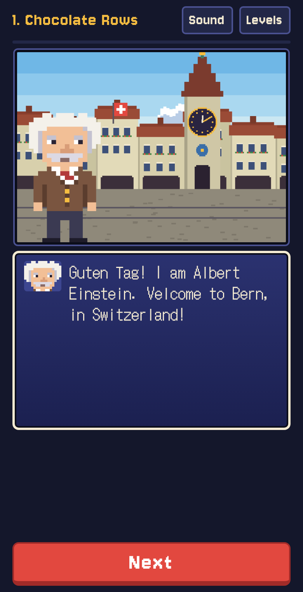
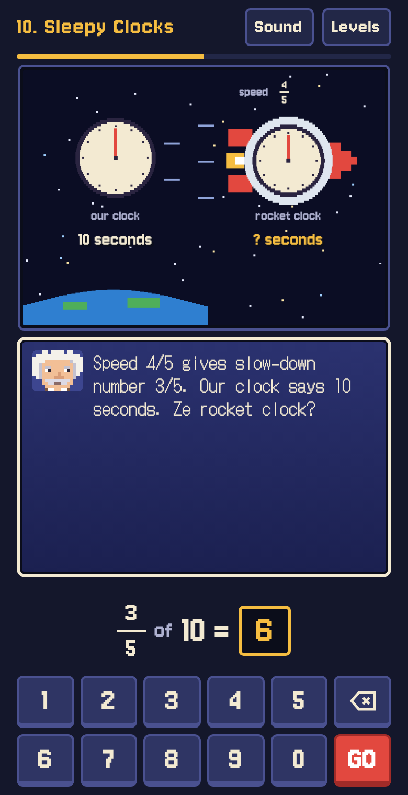

# Relativity

A mobile web teaching game for special relativity, featuring Albert Einstein in Bern, Switzerland.

<div style="display: flex; justify-content: space-between;">
  
  
</div>

**Play it:** https://jdonald.github.io/relativity/

Relativity takes a second grader from sharing chocolate bars all the way to time dilation, length contraction and E = mc². A pixel-art Einstein with a German grandpa accent narrates each step, and every answer is a whole number typed on an on-screen keypad. It is a single self-contained `index.html` with no build step, sized for a phone.

## Levels

| # | Level | What it teaches |
|---|-------|-----------------|
| 1 | Chocolate Rows | Multiplication as rows of chocolate |
| 2 | Fair Shares | Division as sharing onto plates |
| 3 | Parentheses First | Order of operations: "the hug goes first" |
| 4 | Squares | Squaring with tiles, and "square first, then multiply" |
| 5 | Square Roots | Building a square from a pile of tiles |
| 6 | Pieces of Cheese | Fractions, 1 ÷ ¼ = 4, and "3/5 of 10" |
| 7 | Ze Fastest Zing | The speed of light, and speeds as fractions of it |
| 8 | Fraction Tricks | Squaring, subtracting and rooting fractions |
| 9 | Ze Slow-Down Machine | √(1 − v²/c²) as a three-step machine |
| 10 | Sleepy Clocks | Time dilation, the light clock and the twins |
| 11 | Ze Magic Bomb | How fast to fire a starlight bomb so its 3-second fuse pops at a bridge 4 light-seconds away |
| 12 | Squishy Rockets | Length contraction |
| 13 | Ze Fly-Over | How fast to fly so a 200 cm Michael Jordan looks 120 cm tall |
| 14 | E = mc² | Mass as energy, and how much antimatter a trip to Mars needs |

The numbers are chosen so every answer stays whole: speeds of 3/5 and 4/5 of light give slow-down factors of 4/5 and 3/5, and c is rounded to 3 × 10⁸ m/s.

## Features

- **Voice:** Einstein speaks through the device's built-in speech voices. The game looks for an older male English voice first (iOS and macOS ship one called "Grandpa"). The **Sound** button lists every English and German voice on the device so you can pick one, and devices without speech fall back to a grandpa-like mumble.
- **Cutscenes:** pixel-art scenes of Bern (clock tower, trams, the patent office), the Alps, space and a Swiss meadow.
- **Visual explanations:** each problem has its own animated picture, and wrong answers bring a spoken hint plus a visual one.
- **Progress:** stars are saved in the browser. The Levels screen has a "Grown-ups: unlock all levels" switch.

## Running locally

Open `index.html` in a browser, or serve the folder:

```sh
python3 -m http.server 8000
```

## Development history

The game was written by Claude (Anthropic's AI model, configured as **Claude Opus 5.5**, `claude-opus-5-5`) in the Claude app in October 2026, published as a Claude artifact, then moved to this repository.

- **2026-10-10, version 1 (13 levels).** Built from the initial prompt below. An automated Playwright playthrough of every level at phone size drove the follow-up fixes: layout and text-fit, swapping the body font to DotGothic16 for readability (the first font drew 5 like S and Z like 2), redrawing the lying-down basketball player, and showing the solved values in the Slow-Down Machine.
- **2026-10-10, version 2 (14 levels).** Added Einstein's spoken voice using the Web Speech API, with a voice picker and a mumble fallback. Added level 14, E = mc², plus a short "square first, then multiply" lesson in level 4 to build up to it.
- **2026-10-19.** Moved to GitHub with GitHub Pages hosting.

### Initial prompt

> Build a game to play here in Claude mobile called "Relativity" designed to expose someone at a second grade level to special relativity with a series of fun math/physics problems. The between-levels "cinematics", even if at SNES level quality, should feature Einstein talking in his German grandpa accent in Switzerland where special relativity was discovered/formulated.
>
> As even the most basic special relativity equations like time dilation involve some math: and and as early 2nd graders are not yet familiar with division, squaring, square roots, or even parentheses order of operations, the early levels should introduce and test these math concepts to help the player proceed. We also don't do decimals at this stage, but maybe you can get around that with fractions e.g. 1 / (1/4) =4
>
> Ultimately the higher levels of the game should touch upon fun problems like time dilation, e.g. how fast to shoot this magic bomb so that it time dilates to explode right at the bridge. Or length contraction: if our antimatter-propelled fast ship flies over Michael Jordan lying down, how fast to make him exactly as tall as a 2nd grader. Both the early and later levels should feature interesting graphics (for basic math concepts like squaring or division, to physics concepts like length contraction) to explain ahead of the problem and interesting animations if possible upon success. You can do things like round the speed of light to 3e8, use numbers where you get a nice round sqrt(16) or sqrt(25), etc, if that can make for cleaner integral correct answers for the user to solve problems.

### Follow-up prompt (version 2)

> So far so good. Improvements desired:
> * add audible voice. Ideally should sound like old man Grandpa with a German accent. If we run into the problem of the only German accent built-in being female, it's fine to use any old man high pitch grandpa reminiscent of Einstein.
> * we need to incorporate E = mc^2 somehow so add a level for that after the length contraction one. Nuclear bombs are a bit much for kids but anything else like a nuclear battery or antimatter mass required to power a spaceship could be fine. If any earlier levels need to add in background building up to this, fine to augment/add those in.

## Credits

Fonts: [Jersey 10](https://fonts.google.com/specimen/Jersey+10) and [DotGothic16](https://fonts.google.com/specimen/DotGothic16) from Google Fonts. All art is drawn in code on a canvas.

## License

MIT. See [LICENSE](LICENSE).
